<div align="center">

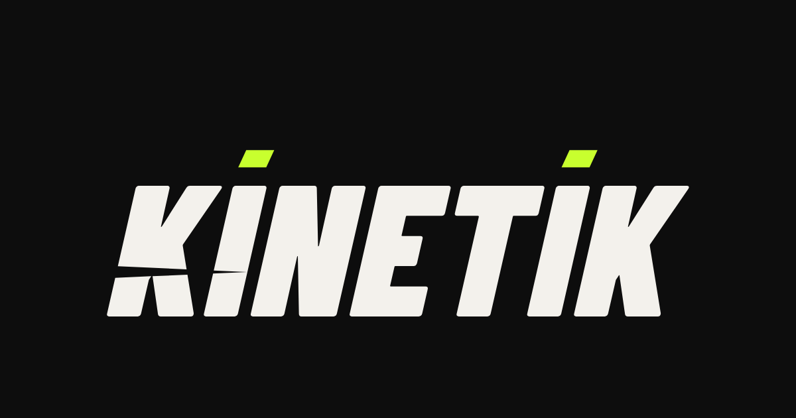

### Türkiye için açık kaynak WooCommerce spor giyim teması

Mobil öncelikli tasarım · İl/İlçe/Mahalle adres sistemi · Mesafeli satış sözleşmeleri · Beden seçici · Ücretsiz kargo çubuğu · Stok bildirimi · Google Shopping feed

[](https://wordpress.org)
[](https://woocommerce.com)
[](https://php.net)
[](LICENSE)
[](https://erusoft.com)

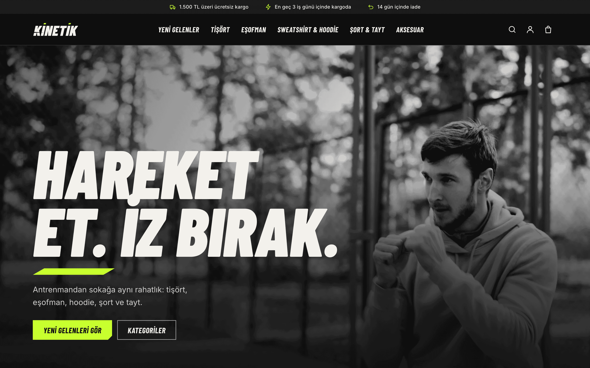

</div>

---

## Neden KİNETİK?

Türkiye'de WooCommerce ile mağaza açanlar aynı engellere takılır: hazır temalar yurt dışı checkout'u varsayar, adres formu il/ilçe bilmez, mesafeli satış sözleşmesi elle yapıştırılır, mobil görünüm ise sonradan düşünülür.

KİNETİK, Türkiye'deki spor giyim mağazaları için sıfırdan yazılmış açık kaynak bir WooCommerce temasıdır. Tema ve dört eklentiden oluşur. Page builder, ağır eklenti yığını ya da lisans anahtarı yoktur.

- ⚡ **Hafif.** Klasik PHP tema, WooCommerce'in varsayılan CSS'i yüklenmez, alan bazlı CSS dosyaları sayfaya göre yüklenir, görseller WebP üretilir.
- 📱 **Mobil öncelikli.** Her ekran 390 px'te test edildi: çekmece menü, filtre çekmecesi, beden tablosu penceresi.
- 🇹🇷 **Türkiye'ye özel.** NVİ verisiyle il → ilçe → mahalle → sokak seçimi, sipariş anına özel Mesafeli Satış ve Ön Bilgilendirme, Havale/EFT akışı, TL formatı.
- 🧩 **Ayrıştırılabilir.** Eklentiler temadan bağımsızdır; istediğinizi başka bir temayla kullanabilirsiniz.

## Ekran görüntüleri

<table>
  <tr>
    <td width="33%">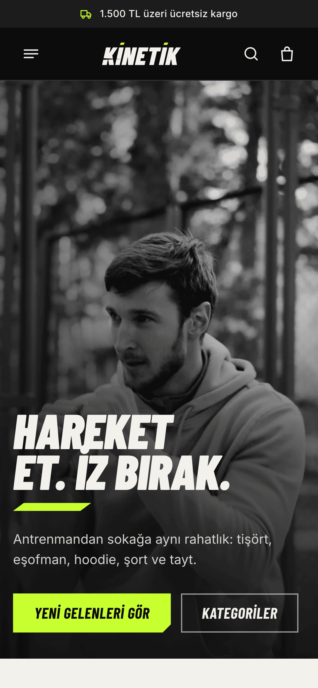<br><sub><b>Ana sayfa</b>: tam ekran hero, kategori kartları</sub></td>
    <td width="33%">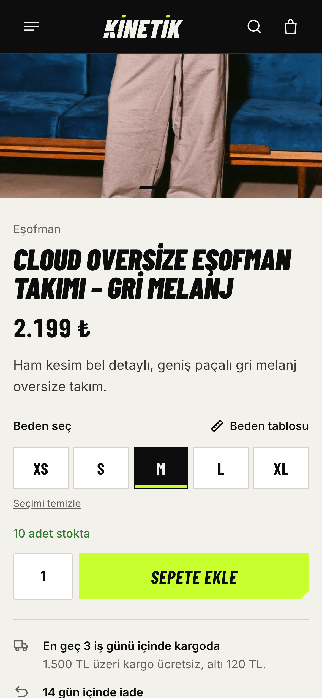<br><sub><b>Ürün sayfası</b>: beden butonları, güven satırı</sub></td>
    <td width="33%">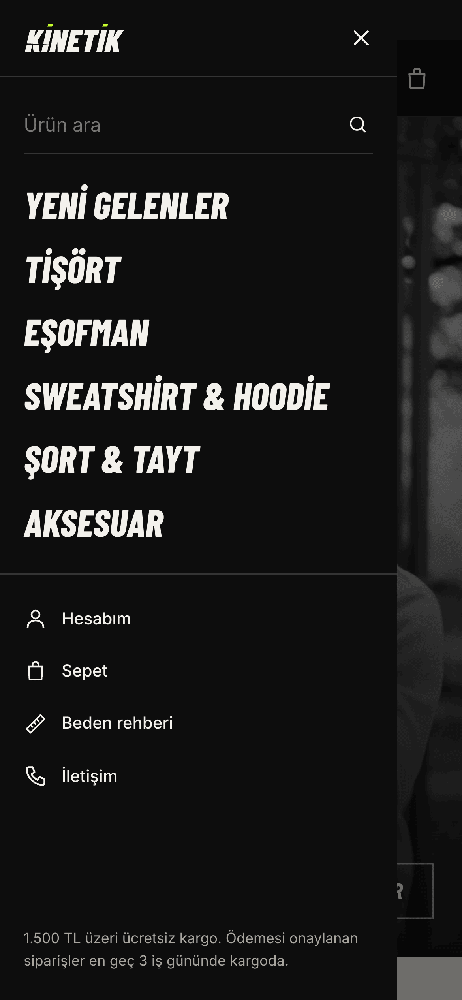<br><sub><b>Çekmece menü</b>: arama ve hızlı linkler</sub></td>
  </tr>
  <tr>
    <td>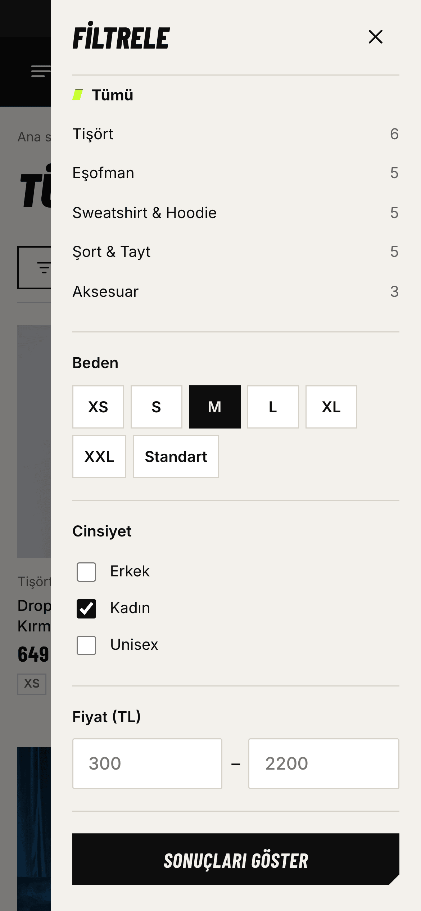<br><sub><b>Filtre çekmecesi</b>: kategori, beden, cinsiyet, fiyat</sub></td>
    <td>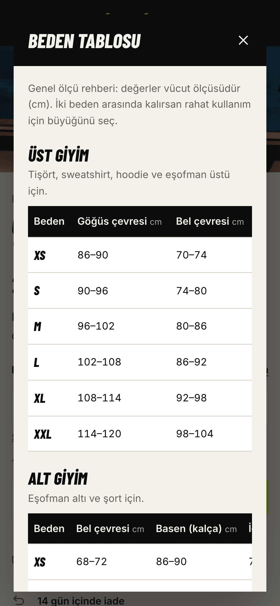<br><sub><b>Beden tablosu</b>: ürün sayfasında açılır pencere</sub></td>
    <td>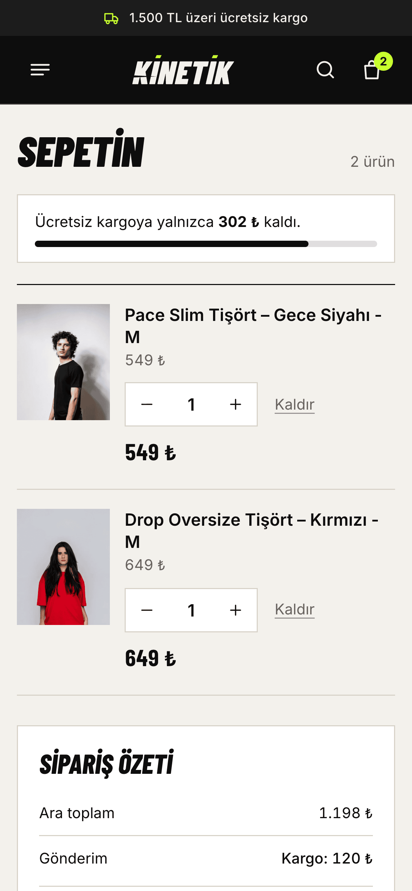<br><sub><b>Sepet</b>: adet, kupon, kargo çubuğu</sub></td>
  </tr>
</table>

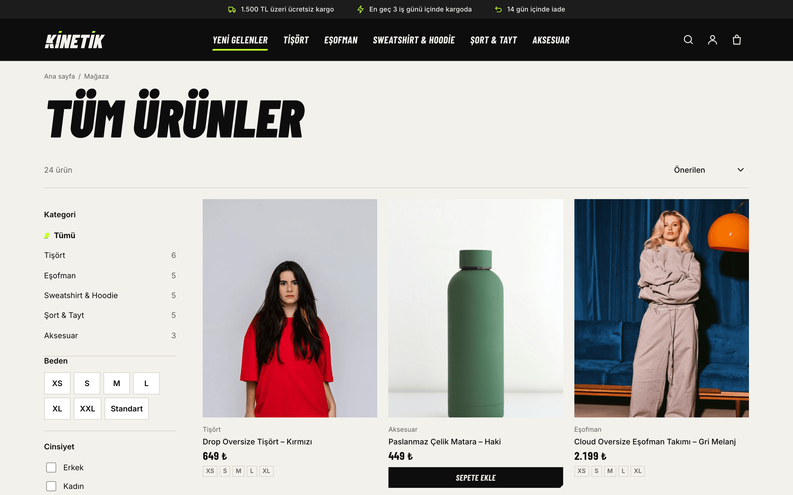
<sub><b>Mağaza:</b> filtre paneli, sıralama, ikinci görsel hover'ı, indirim rozetleri</sub>

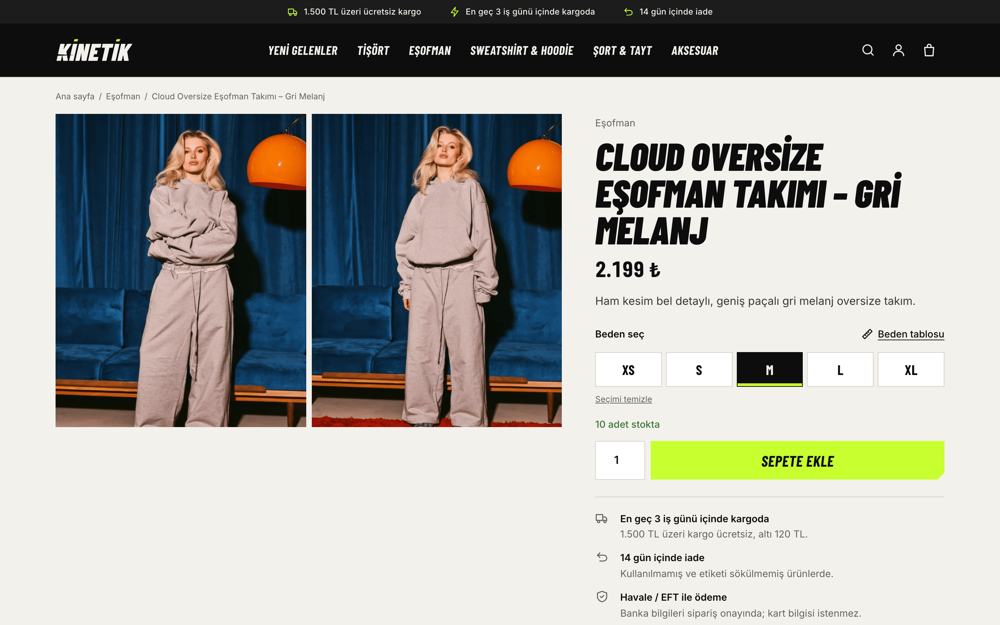
<sub><b>Ürün sayfası:</b> galeri, beden seçici, beden tablosu, açılır açıklama bölümleri, benzer ürünler</sub>

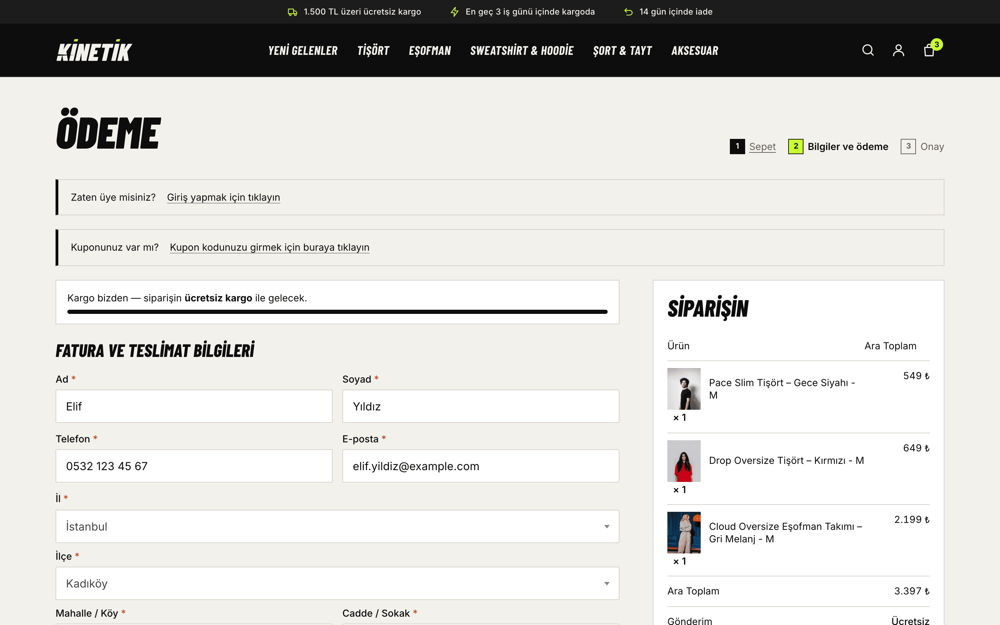
<sub><b>Ödeme:</b> iki kolon düzen, TR adres alanları, sözleşme onayları, Havale/EFT</sub>

## Paket içeriği

```
themes/kinetik/                tema
plugins/kinetik-sozlesmeler/   Mesafeli Satış + Ön Bilgilendirme
plugins/kinetik-tr-adres/      İl → İlçe → Mahalle → Sokak checkout
plugins/kinetik-marketing/     ücretsiz kargo çubuğu + e-posta kaydı & kupon
plugins/kinetik-growth/        Havale hatırlatma, yorum isteği, stok bildirimi, Google feed
demo/                          kurulum betikleri + 24 ürünlük demo katalog (görseller dahil)
tools/make-logo.py             logo/favicon setini üreten araç
```

## 🎨 Tema: `kinetik`

Klasik (blok olmayan) WooCommerce teması. Siyah zemin, kırık beyaz yüzeyler ve sadece aksiyon anlarında kullanılan volt yeşili. Başlıklarda Barlow Condensed (eğik, kalın), metinde Inter.

| Alan | Neler var |
|---|---|
| **Ana sayfa** | Tam ekran hero (masaüstü ve mobil için ayrı kırpım), kategori kartları, "Yeni gelenler" (yalnızca stokta olanlar), kupon bandı, lookbook, güven rozetleri |
| **Mağaza / kategori** | Filtre paneli (kategori, beden, cinsiyet, fiyat), mobil filtre çekmecesi, sıralama, "Daha fazla göster", filtreli sayfalara `noindex` |
| **Ürün sayfası** | 4:5 galeri, tema içi **beden butonları** (WooCommerce varyasyon JS'i bozulmadan), tükenen beden üstü çizili, **beden tablosu** penceresi, AJAX sepete ekleme + toast, açılır açıklama/özellik/kargo bölümleri |
| **Sepet / ödeme / hesabım** | Kart düzenli sepet ve otomatik güncellenen adet, iki kolon ödeme, adımlı başlık, kart tabanlı hesap paneli |
| **Sayfalar** | İletişim (form + satıcı künyesi), Beden Rehberi, SSS, yasal sayfalar, 404, arama, çerez çubuğu |
| **SEO** | Başlık ve açıklama, canonical, Open Graph/Twitter, Organization + WebSite + Product JSON-LD |

**Filtreler**

| Filtre | Varsayılan | Ne yapar |
|---|---|---|
| `kinetik_footer_credit` | Erusoft linki | Footer'daki geliştirici imzası. Kaldırmak için `__return_empty_string` |
| `kinetik_dispatch_days` | `3` | "En geç X iş günü içinde kargoda" metinleri |
| `kinetik_return_days` | `14` | İade süresi metinleri (yasal minimumun altına inmez) |
| `kinetik_free_shipping_threshold` | WooCommerce ayarı | Ücretsiz kargo eşiği |
| `kinetik_flat_shipping_cost` | WooCommerce ayarı | Sabit kargo ücreti |
| `kinetik_welcome_coupon` | `MERHABA5` | Bülten bandında gösterilen kupon |
| `kinetik_brand_name` | Site başlığı | E-postalarda ve feed'de marka adı |

```php
// Örnek: footer imzasını kaldır, kargo süresini 1 gün yap
add_filter('kinetik_footer_credit', '__return_empty_string');
add_filter('kinetik_dispatch_days', fn() => 1);
```

## 🧩 Eklentiler

### 📜 KİNETİK Sözleşmeler: `kinetik-sozlesmeler`

Mesafeli Satış Sözleşmesi ve Ön Bilgilendirme Formu'nu **siparişe özel** üretir: alıcı, ürünler, fiyatlar, kargo, ödeme yöntemi ve satıcı künyesi o anki sepetle doldurulur.

- Ödeme adımında iki **ayrı** onay kutusu. İşaretlenmeden sipariş oluşmaz.
- "Sözleşmeyi oku" ile siparişe özel metin açılır pencerede görünür.
- Onay kaydı (IP, tarayıcı, zaman) ve sözleşmelerin **anlık kopyası** siparişe yazılır. Sonradan sayfa değişse bile müşterinin onayladığı metin korunur.
- Kopya müşterinin sipariş e-postasına ve **Hesabım → Siparişler** ekranına eklenir.
- Ticari ileti (pazarlama izni) isteğe bağlı üçüncü onay kutusu olarak alınır ve kaydedilir.
- Satıcı künyesi (ünvan, adres, vergi, MERSİS, IBAN…) **tek yerden** yönetilir: WooCommerce → Sözleşmeler. Boş alanlar sayfalarda "eklenecek" olarak işaretlenir, uydurma veri basılmaz.

<table>
  <tr>
    <td width="50%">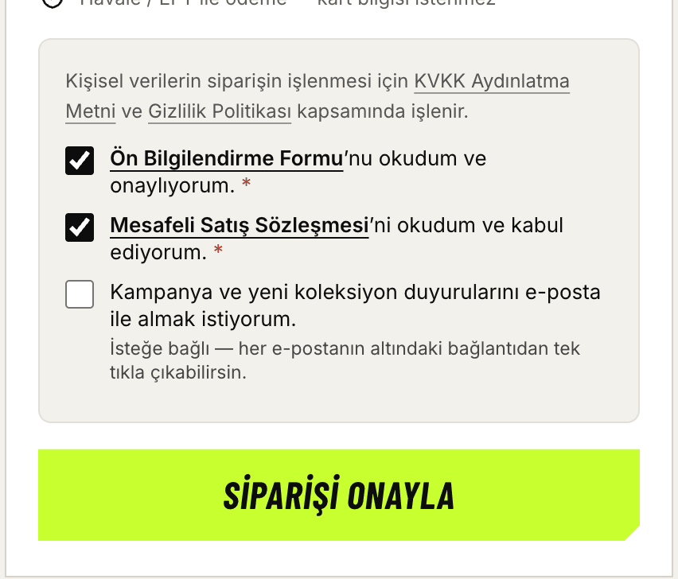<br><sub>Ödeme adımında iki ayrı onay</sub></td>
    <td width="50%">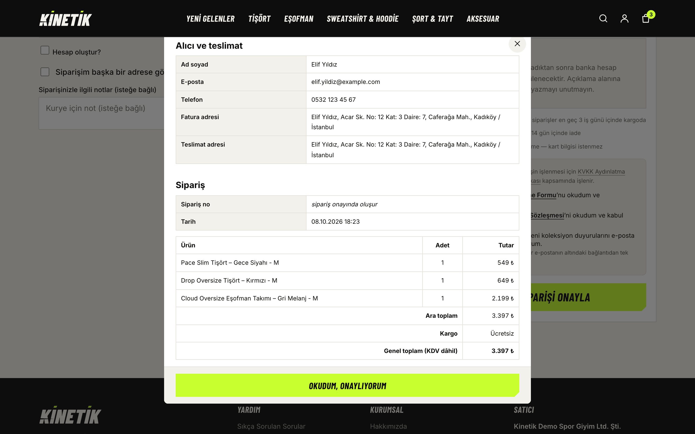<br><sub>Siparişe özel sözleşme metni</sub></td>
  </tr>
</table>
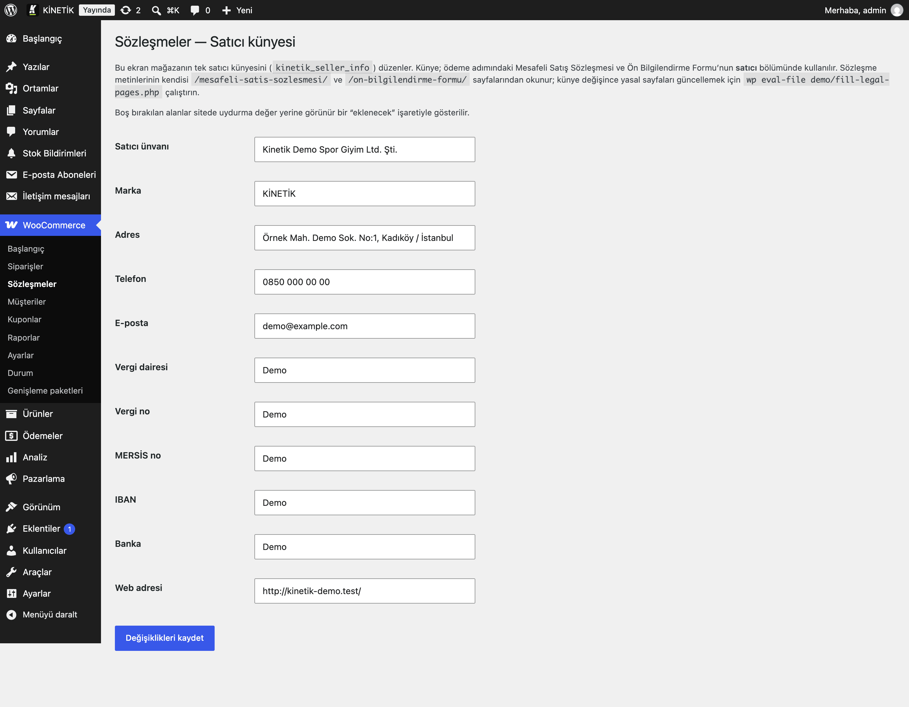
<sub>Satıcı künyesi: footer, iletişim, yasal sayfalar ve sözleşmeler buradan beslenir</sub>

### 📍 KİNETİK TR Adres: `kinetik-tr-adres`

Checkout'taki serbest metin adres alanlarının yerine **İl → İlçe → Mahalle → Cadde/Sokak** kademeli seçim gelir. Veri NVİ (Nüfus ve Vatandaşlık İşleri) idari adres verisinden derlenmiştir ve eklentiyle birlikte gelir; dış API çağrısı yapılmaz.

- Ülke seçici kaldırılır, Türkiye sabitlenir.
- Fatura ve teslimat adresi ayrı ayrı çalışır. "Farklı adrese gönder" seçilmezse teslimat adresi faturadan **eksiksiz** kopyalanır.
- Seçimler siparişe, e-postalara ve admin ekranına düzgün biçimlendirilmiş olarak yansır.
- Kargo firmasına doğru adres gider, "mahalle yazmayı unuttum" hataları biter.

> Klasik checkout ister: sepet ve ödeme sayfaları `[woocommerce_cart]` / `[woocommerce_checkout]` kısa kodlarını kullanmalı. Demo kurulum betiği bunu otomatik ayarlar.

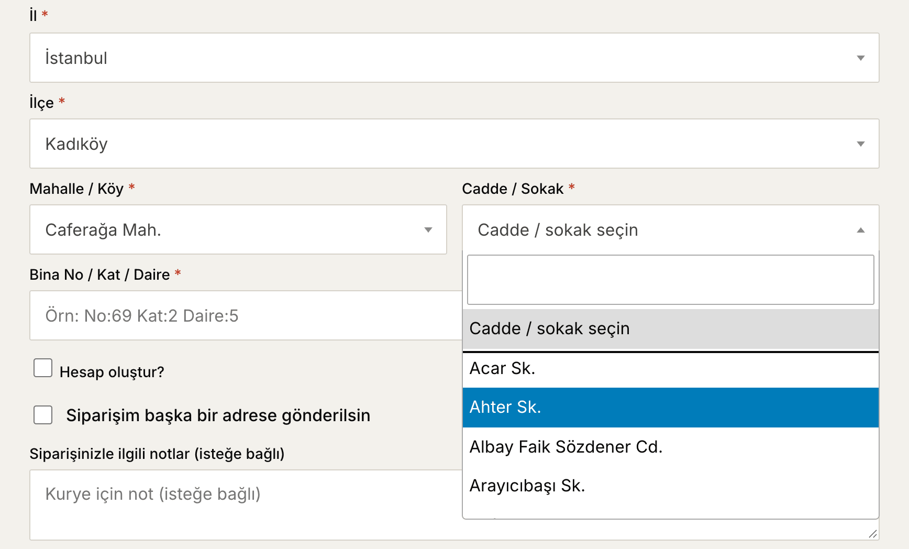

### 📈 KİNETİK Marketing: `kinetik-marketing`

Abartısız, dürüst pazarlama araçları. Sahte geri sayım ya da uydurma "son 2 ürün!" uyarısı yoktur.

- **Ücretsiz kargo çubuğu:** sepette "Ücretsiz kargoya X TL kaldı". Eşik WooCommerce'in ücretsiz kargo ayarından okunur. Ücretsiz kargo kazanılınca ücretli seçenek otomatik gizlenir (WooCommerce varsayılan olarak ilk yöntemi seçtiği için müşteri yanlışlıkla ücret ödeyebiliyordu).
- **E-posta kaydı ve hoş geldin kuponu:** AJAX form, KVKK onay metni, onay zamanı ve IP kaydı, abone listesi admin'de. Kayıt sonrası kupon kodu anında gösterilir.
- Kısa kodlar: `[kinetik_free_shipping_bar]`, `[kinetik_newsletter]`

<table>
  <tr>
    <td width="50%">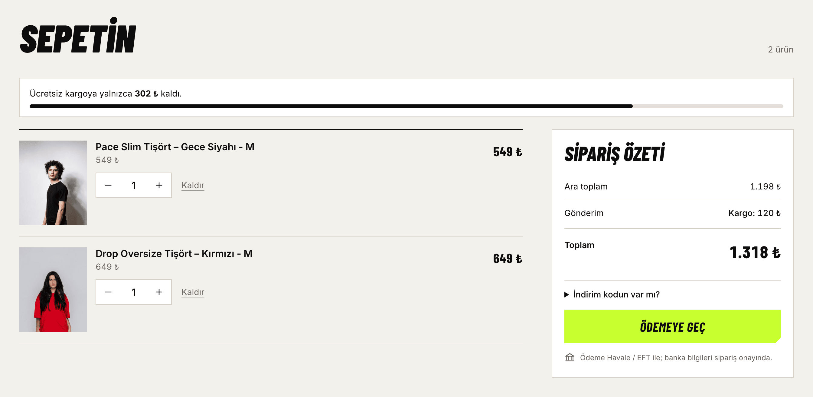<br><sub>Eşiğe kalan tutar</sub></td>
    <td width="50%">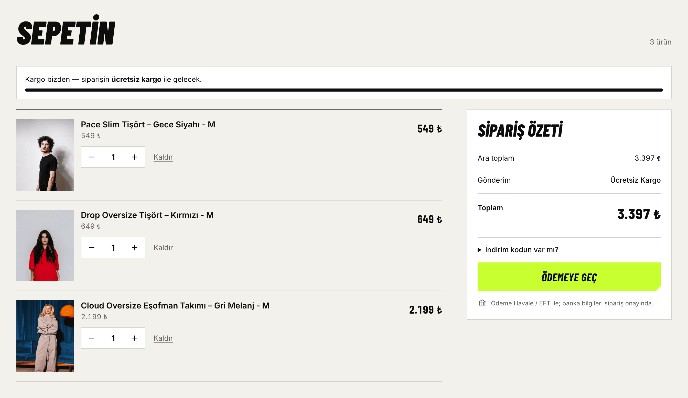<br><sub>Ücretsiz kargo kazanıldı</sub></td>
  </tr>
</table>


### 🚀 KİNETİK Growth: `kinetik-growth`

Satışı arttıran, cron tabanlı arka plan otomasyonları:

- **Stoğa gelince haber ver:** tükenen **beden** seçildiğinde ürün sayfasında "Haber ver" kartı açılır. Beden stoğa döndüğünde aboneye tek bir e-posta gider. Ürün tamamen tükendiğinde de çalışır.
- **Havale/EFT hatırlatma:** ödemesi gelmemiş Havale siparişlerine bir kez, kibar bir hatırlatma e-postası.
- **Değerlendirme isteği:** sipariş tamamlandıktan 7 gün sonra bir kez yorum isteği.
- **Google Shopping feed:** `/?kinetik_feed=google`. Her beden ayrı satır (`item_group_id`), beden, cinsiyet, yaş grubu ve eşiğe göre kargo bilgisi.

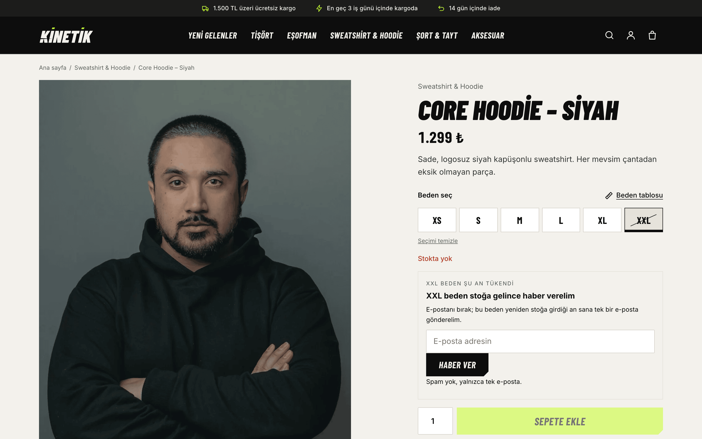

## Kurulum

**Gereksinimler:** WordPress 6.5+, WooCommerce 9+, PHP 8.0+ (WordPress 7.1, WooCommerce 10.9, PHP 8.3/8.4 ile test edildi)

1. `themes/kinetik` klasörünü `wp-content/themes/` altına, `plugins/` altındaki dört klasörü `wp-content/plugins/` altına kopyalayın.
2. Temayı ve istediğiniz eklentileri etkinleştirin.
3. **WooCommerce → Sözleşmeler** ekranından satıcı künyenizi girin.
4. Sepet ve ödeme sayfalarının kısa kod sürümünde olduğundan emin olun (TR adres için).

### Demo mağazayı birebir kurmak (WP-CLI)

Boş bir WordPress + WooCommerce kurulumunda, eklenti ve tema etkinken:

```bash
wp eval-file demo/setup-store.php      # mağaza ayarları, kategoriler, beden/cinsiyet özellikleri, sayfalar, menüler, kargo, kupon
wp eval-file demo/theme-setup.php      # menü konumları + site simgesi
wp eval-file demo/fill-legal-pages.php # KVKK, gizlilik, çerez, mesafeli satış, ön bilgilendirme, iptal-iade
wp eval-file demo/import-products.php  # 24 ürün, 108 beden varyasyonu, görseller
wp media regenerate --yes              # 4:5 WebP ürün görselleri
```

Betikler idempotenttir; tekrar çalıştırmak çift kayıt oluşturmaz. Demo satıcı bilgileri bilerek **uydurmadır** ("Kinetik Demo Spor Giyim Ltd. Şti."); canlıya almadan önce kendi bilgilerinizi girin.

### Kendi logonuz

`tools/make-logo.py` içindeki `NAME` / `WORD` / `MARK` değerlerini değiştirip çalıştırın. Wordmark, monogram, açık/koyu/tek renk SVG ve PNG, favicon, apple-touch ve OG görseli fontsuz SVG path olarak üretilir:

```bash
python3 -m venv /tmp/logo && /tmp/logo/bin/pip install fonttools skia-pathops pillow
/tmp/logo/bin/python tools/make-logo.py
```

## ⚠️ Yasal not

Yasal sayfa ve sözleşme şablonları başlangıç noktasıdır, hukuki danışmanlık değildir. Satışa açmadan önce metinleri kendi iş modelinize göre bir hukukçuya kontrol ettirin.

## 🔗 Diğer WordPress / WooCommerce eklentilerim

> Tüm eklentilerin güncel listesi, açıklamaları ve indirmeleri: **[wordpress.erusoft.com](https://wordpress.erusoft.com)** ([kaynak](https://github.com/erayusta/erusoft-wp))

| Eklenti | Ne işe yarar |
|---|---|
| **Ödeme** | |
| [metropolcard-for-woocommerce](https://github.com/erayusta/metropolcard-for-woocommerce) | MetropolCard vPos-OTP ödeme: kart no + SMS OTP ile checkout içinde ödeme, iptal/iade, HPOS uyumlu |
| [edenred-for-woocommerce](https://github.com/erayusta/edenred-for-woocommerce) | Edenred (Ticket Restaurant) sanal POS ödeme ağ geçidi |
| [pluxee-for-woocommerce](https://github.com/erayusta/pluxee-for-woocommerce) | Pluxee (Sodexo) Türkiye mobil ödeme kodu (OTP) ile ödeme, iade ve işlem kayıtları |
| **Pazaryeri** | |
| [erusoft-woocommerce-trendyol](https://github.com/erayusta/erusoft-woocommerce-trendyol) | Trendyol siparişlerini WooCommerce'e izole aktarır; stok/ERP/kargo akışını tetiklemez |
| [erusoft-woocommerce-hepsiburada](https://github.com/erayusta/erusoft-woocommerce-hepsiburada) | Hepsiburada siparişlerini WooCommerce'e izole aktarır |
| **Pazarlama & feed** | |
| [splitshare-affiliates-for-woocommerce](https://github.com/erayusta/splitshare-affiliates-for-woocommerce) | Influencer affiliate programı: komisyon ile takipçi indirimi arasında paylaşılan sabit pay |
| [akakce-xml-feed](https://github.com/erayusta/akakce-xml-feed) | WooCommerce ürünlerinden Akakçe XML feed'i |
| **Fatura & servis** | |
| [efatura](https://github.com/erayusta/efatura) | WooCommerce e-Fatura eklentisi |
| [yetkiliservis](https://github.com/erayusta/yetkiliservis) | Yetkili servisleri harita üzerinde listeleme |
| **Veri & araçlar** | |
| [erusoft-turkiye-adres-verisi](https://github.com/erayusta/erusoft-turkiye-adres-verisi) | Türkiye il/ilçe/mahalle/sokak idari adres verisi toplayıcı + yerel PHP/MySQL API |
| [wp-ai-toolkit](https://github.com/erayusta/wp-ai-toolkit) | WordPress geliştirme için MCP sunucusu: Claude Code, Cursor, VS Code, Gemini CLI ile çalışır |

## Katkı

Hata bildirimi ve önerilere açığız: [Issues](https://github.com/erayusta/kinetik/issues). Pull request'ler memnuniyetle karşılanır.

## Lisans ve kaynaklar

- Kod: [GPL-2.0-or-later](LICENSE), WordPress ve WooCommerce ile aynı lisans ailesi.
- Font: Barlow Condensed ve Inter, [SIL Open Font License](tools/fonts/OFL.txt).
- Demo ürün görselleri: [Unsplash License](https://unsplash.com/license), tek tek kaynakları [`demo/images/CREDITS.md`](demo/images/CREDITS.md) dosyasında.
- Tema editoryal görselleri: [Unsplash License](https://unsplash.com/license), kaynakları [`themes/kinetik/assets/CREDITS.md`](themes/kinetik/assets/CREDITS.md) dosyasında.
- Adres verisi: T.C. İçişleri Bakanlığı NVİ idari adres verisi.

---

<div align="center">
<sub>Tasarım & geliştirme <a href="https://erusoft.com"><b>Erusoft</b></a> · Türkiye'de e-ticaret yapanlar için ❤️ ile</sub>
</div>
